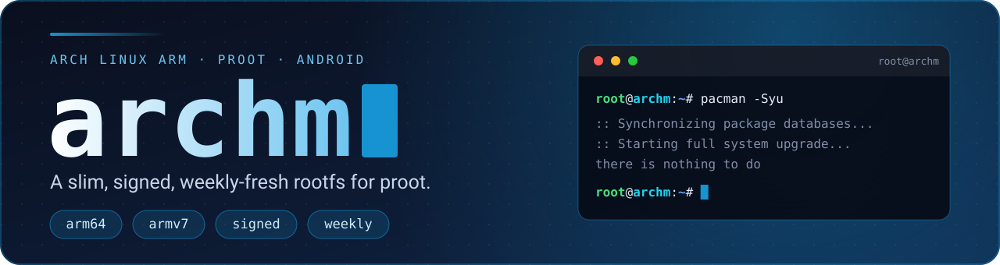
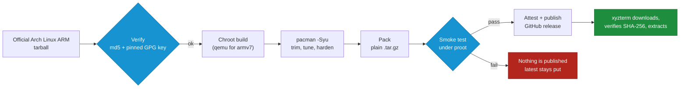

<div align="center">



<p>
  <b>A slim, signed, weekly-rebuilt <a href="https://archlinuxarm.org">Arch Linux ARM</a> rootfs, tuned for <a href="https://proot-me.github.io">proot</a> on Android.</b><br>
  Made for <a href="https://github.com/vxyzview/xyzterm">xyzterm</a>.
</p>

<p>
  <a href="https://github.com/vxyzview/archm/actions/workflows/release.yml"></a>
  <a href="https://github.com/vxyzview/archm/releases/latest"></a>
  <a href="https://github.com/vxyzview/archm/releases"></a>
  
  
  <a href="LICENSE"></a>
</p>

<p>
  <a href="#-quick-start">Quick start</a> ·
  <a href="#-how-it-is-built">How it is built</a> ·
  <a href="#-what-archm-changes">What archm changes</a> ·
  <a href="#-make-proot-faster">Make proot faster</a> ·
  <a href="#-releases-and-updates">Releases</a> ·
  <a href="#-build-it-yourself">Build it yourself</a> ·
  <a href="#-troubleshooting">Troubleshooting</a> ·
  <a href="#-faq">FAQ</a>
</p>

</div>

---

## ✨ Highlights

<table>
<tr>
<td width="33%" valign="top">

**🪶 Slim**<br>
No kernel, firmware or U-Boot. Docs, translations and the useless hardware databases are left out, so there are far fewer files to unpack.

</td>
<td width="33%" valign="top">

**⚡ proot-ready**<br>
`pacman -Syu` works out of the box. Fork-free login scripts, a hardlink-free tarball, and a prompt that says `archm`, not `localhost`.

</td>
<td width="33%" valign="top">

**✅ Verified**<br>
The base tarball is checked against the pinned Arch Linux ARM key. Every tarball has a SHA-256 file, every release a signed build-provenance attestation.

</td>
</tr>
<tr>
<td width="33%" valign="top">

**🔄 Fresh**<br>
Rebuilt every Monday from the newest official tarball with a full `pacman -Syu`. The release notes list what changed.

</td>
<td width="33%" valign="top">

**🧪 Tested**<br>
Every build runs an offline test suite, then boots the real image under proot for both ABIs. A failing image is never published.

</td>
<td width="33%" valign="top">

**🔑 Safe defaults**<br>
No default passwords: the stock `alarm` user is gone and root is locked. No SSH host keys baked into the image.

</td>
</tr>
</table>

## 🚀 Quick start

| ABI (xyzterm) | Arch Linux ARM | Always-latest download |
|---|---|---|
| `arm64` | aarch64 | [`archm-arm64.tar.gz`](https://github.com/vxyzview/archm/releases/latest/download/archm-arm64.tar.gz) · [sha256](https://github.com/vxyzview/archm/releases/latest/download/archm-arm64.tar.gz.sha256) |
| `arm` | armv7 | [`archm-arm.tar.gz`](https://github.com/vxyzview/archm/releases/latest/download/archm-arm.tar.gz) · [sha256](https://github.com/vxyzview/archm/releases/latest/download/archm-arm.tar.gz.sha256) |

Every release also carries `SHA256SUMS`, `manifest.json` (tag, URL, SHA-256, size, `files` and `uncompressed_bytes` per ABI)
and `*.packages.txt`. Tags are dates: `2026.11.20`, and `2026.11.20.1` for a second build the same day. The tag is also the
`VERSION` inside the image (`/etc/archm-release`), so a launcher can compare what is installed with the `tag` in `manifest.json`.

**Verify a download** (integrity, and proof that this repository's workflow built it):

```sh
base=https://github.com/vxyzview/archm/releases/latest/download
curl -LO "$base/archm-arm64.tar.gz" -O "$base/archm-arm64.tar.gz.sha256"
sha256sum -c archm-arm64.tar.gz.sha256
gh attestation verify archm-arm64.tar.gz --repo vxyzview/archm
```

**Just try it** in Termux with the reference launcher (`archm-arm.tar.gz` on a 32-bit phone). The rootfs goes to `~/archm`;
once inside, `update` is an alias for `pacman -Syu`:

```sh
pkg install proot curl
curl -LO https://github.com/vxyzview/archm/releases/latest/download/archm-arm64.tar.gz
mkdir -p ~/archm && tar -xzf archm-arm64.tar.gz -C ~/archm
curl -LO https://raw.githubusercontent.com/vxyzview/archm/main/extras/start-archm.sh
bash start-archm.sh
```

### Use it in xyzterm

1. *Maintainers:* create the GitHub repo `archm` from these files, then **Actions → release → Run workflow** for the first release.
2. In xyzterm, replace the Ubuntu rootfs source with archm, per ABI: the release URL
   (`https://github.com/vxyzview/archm/releases/latest/download/archm-<abi>.tar.gz`) and its pinned SHA-256
   (`archm-<abi>.tar.gz.sha256`, or `manifest.json` if you want the app to look it up).
3. What the extractor can rely on:
   - plain `.tar.gz`; entries start at `./` (`./bin`, `./etc`, ...)
   - no hardlinks, no device nodes, no xattrs; `dev`, `proc` and `sys` are empty
   - shell `/bin/bash`; the first command to run is `pacman -Syu`
   - `manifest.json` gives `uncompressed_bytes` (the file data once unpacked: check free space before extracting; directories
     and metadata come on top) and `files` (entries in the tarball: show progress by count)
4. Anything in the app that assumes Ubuntu (apt commands, `/etc/lsb-release`, `pfetch` tweaks) needs a pacman equivalent.

> [!NOTE]
> Shell setup lives in `/etc` (`/etc/profile.d/archm.sh`, `/etc/archm/bashrc`) on purpose: xyzterm binds `/root` and `/home`
> to Android storage, so dotfiles baked into them would be hidden. Put your own tweaks in `~/.bashrc`.

## 🧱 How it is built



| Step | Where |
|---|---|
| Download, verify, chroot, customise, pack | [`build.sh`](build.sh) and [`scripts/customize.sh`](scripts/customize.sh) |
| Settings: locale, timezone, extra packages, slimming | [`config.env`](config.env) |
| Files that land in the image | [`rootfs-overlay/`](rootfs-overlay) |
| Offline tests, including a fake-chroot end-to-end build | [`tests/`](tests) |
| Boot the real image as a normal user under proot | [`scripts/smoke-proot.sh`](scripts/smoke-proot.sh) |
| Release notes, manifest, pruning | [`scripts/publish.sh`](scripts/publish.sh) |
| Reference launcher with the proot flags that matter | [`extras/start-archm.sh`](extras/start-archm.sh) |

## 📦 What archm changes

Compared with the stock Arch Linux ARM tarball:

| Change | Why it matters under proot |
|---|---|
| `DisableSandbox` in `pacman.conf`; no `DownloadUser`, no `CheckSpace` | pacman 7's download sandbox needs Landlock/seccomp, which proot/Android generally can't give. Without this, `pacman -Syu` fails. |
| Kernel, headers, firmware, U-Boot, initramfs tools removed | The Android kernel is what runs. Far fewer files and bytes to extract and back up. |
| Docs and non-English translations, translated man pages not installed (`NoExtract`, `SLIM=1`) | Fewer files means faster installs and upgrades (every file costs ptrace round-trips). English man pages stay; install `man-db` to read them. |
| Hardware-database pacman hooks masked (`*hwdb*`, `*udev*`), the generated `hwdb.bin` dropped (`SLIM=1`) | They rebuild databases that are useless here and are slow under proot. The hooks are masked before the build's own upgrade too, so the build skips that work as well. |
| `makepkg` uses `-j$(nproc)` | Builds use all cores. |
| Keyring initialised and populated | No slow `pacman-key --init` on first use. |
| `/etc/machine-id` ships empty and is filled on the first login | It has to differ per install, and D-Bus or GUI programs complain without one. The login script does it with shell builtins only, no fork. |
| No default credentials: `alarm` user removed, root locked, no SSH host keys | Stock Arch Linux ARM ships `alarm/alarm` and `root/root`. |
| Static DNS (1.1.1.1, 8.8.8.8), Android group names (`aid_inet`, ...) | Android has no `/etc/resolv.conf`; `id` stops complaining about unknown groups. |
| Fork-free login scripts; prompt says `archm` | Every fork+exec is slow under proot, and Android reports the hostname as `localhost`. |
| Hardlink-free, xattr-free `.tar.gz` | Unpacks on Android without special handling. |

The rootfs is `en_US.UTF-8`, `UTC`. Change `LOCALE`/`TIMEZONE`/`EXTRA_PKGS`/`SLIM` in [`config.env`](config.env).
Get docs and translations back: delete the three `NoExtract` lines in `/etc/pacman.conf`, then reinstall the packages you want them for.

## ⚡ Make proot faster

Launcher and Android side. [`extras/start-archm.sh`](extras/start-archm.sh) is a working reference; port the same ideas into xyzterm's launch command.

**Flags and binds**
- **Never set `PROOT_NO_SECCOMP`.** The seccomp fast path avoids a ptrace stop on most syscalls.
- Use `--link2symlink` (Android forbids hardlinks), `-0` (fake root, pacman needs it) and `--kill-on-exit`.
  Bind as little as possible: each bind adds path-translation work to every `open`.
- Bind `<rootfs>/tmp` to `/dev/shm` (Android has none), `/dev/urandom` to `/dev/random`, and stand-ins for
  `/proc/stat`, `loadavg`, `uptime`, `version` when Android hides them (htop, top, uptime and ps break otherwise).
- Keep proot current (Termux's build). Do not nest proot inside proot.

**Habits**
- Do heavy I/O (git clone, npm, cargo, compiling) inside the rootfs, for example under `/opt`. If `/home` is shared
  storage it goes through FUSE and is much slower than the app's private directory.
- Pass `TZ` from Android into the session if you want local time.

**Android settings**
- Android 12+ may kill proot children (`[Process completed (signal 9)]`). Android 14+: Developer options →
  *Disable child process restrictions*. Android 12-13 over adb:
  `adb shell settings put global settings_enable_monitor_phantom_procs false`.
- Set battery to *Unrestricted* for the app, hold a wake lock for long jobs, and run big `pacman -Syu` upgrades while charging.

## 🔄 Releases and updates

| Trigger | What happens |
|---|---|
| Weekly, Monday 03:17 UTC | Newest official tarball → verify → upgrade everything → test → **publish** |
| Manual: Actions → release → *Run workflow* | The same. Publishing only ever happens from `main`. |
| Push to `main` | Builds and tests (artifacts kept 7 days). Does not publish. |
| Pull request | Offline tests only. |

- **Gate:** the proot smoke test has to pass before anything is published. If it fails, nothing is released and `latest`
  stays on the previous build; the image that failed is kept as a build artifact for 7 days so you can inspect it.
- **Build report:** every build prints package sizes, file count and what hardlinks cost in the job summary: the numbers
  for deciding what to trim next. The smoke test adds login-shell startup time under proot.
- **Signatures:** the base tarball is checked against key `68B3537F39A313B3E574D06777193F152BDBE6A6` (published by Arch Linux ARM).
  A copy is kept in [`keys/archlinuxarm.asc`](keys/archlinuxarm.asc) so a keyserver outage cannot fail the build; only the
  fingerprint is trusted, the file is a convenience (a wrong one just falls back to the keyservers). To refresh it:
  `gpg --keyserver hkps://keyserver.ubuntu.com --recv-keys <fingerprint> && gpg --armor --export <fingerprint> > keys/archlinuxarm.asc`.
- **Supply chain:** each tarball has a signed build-provenance attestation (see *Verify a download*). All GitHub Actions are
  pinned to commit SHAs; Dependabot proposes the updates weekly ([`.github/dependabot.yml`](.github/dependabot.yml)).
- **Retention:** the optional repo variable `KEEP_RELEASES` (for example `12`) deletes older releases and tags.
  Remember xyzterm pins a specific release: do not prune the one it points to.
- **Schedules pause:** GitHub stops scheduled workflows after 60 days without repository activity;
  *Enable workflow* on the Actions tab fixes it if it ever stops.

## 🔧 Build it yourself

Needs a real Linux machine with root (not proot/Termux).

```sh
sudo apt install qemu-user-static binfmt-support libarchive-tools pigz curl gnupg
sudo ./build.sh arm64 dist        # or: arm
bash tests/run.sh                 # offline tests, no root needed
```

Output: `dist/archm-<abi>.tar.gz` (+ `.sha256`, `.packages.txt`, `.info`, `.stats.md`). `KEEP_WORK=1` keeps the temp rootfs for inspection.

`tests/run.sh` uses a few optional tools and skips the test that needs one if it is missing: `python3-yaml` (workflow
syntax), `shellcheck`, and `pacman` plus `fakeroot` (checks what the `NoExtract` lines really do; on Debian/Ubuntu:
`sudo apt install python3-yaml shellcheck pacman-package-manager fakeroot`).

## 🩺 Troubleshooting

<details>
<summary><code>restricting filesystem access failed ... Landlock</code></summary>

`DisableSandbox` is missing from `[options]` in `/etc/pacman.conf`.

</details>

<details>
<summary><code>signature ... is unknown trust</code></summary>

```sh
pacman -Sy archlinuxarm-keyring && pacman-key --populate archlinuxarm
```

</details>

<details>
<summary><code>failed retrieving file ... 404</code></summary>

A mirror is mid-sync. Retry, or pick another in `/etc/pacman.d/mirrorlist`.

</details>

<details>
<summary>Database not found, or <code>target not found</code></summary>

Run `pacman -Syu` first; archm ships without sync databases.

</details>

<details>
<summary>D-Bus or GUI programs complain about the machine ID</summary>

archm fills `/etc/machine-id` on the first login. If it is still empty (the launcher hides `/proc/sys/kernel/random/uuid`,
or never starts a login shell): `dbus-uuidgen --ensure=/etc/machine-id`.

</details>

<details>
<summary><code>sshd</code> has no host keys</summary>

Run `ssh-keygen -A`, and set a root or user password first.

</details>

## ❓ FAQ

<details>
<summary>Is this real root?</summary>

No. proot fakes it (`-0`), which is all pacman needs. Everything still runs as your app's Android user, inside the app's sandbox.

</details>

<details>
<summary>Can I run systemd services?</summary>

No. No init system runs under proot, so systemd units do not start. Start daemons such as `sshd` by hand.

</details>

<details>
<summary>How do I update the system?</summary>

Inside the rootfs run `pacman -Syu` (or the `update` alias). A new release is only for fresh installs: you never have to reinstall to stay current.

</details>

<details>
<summary>Why is there no kernel?</summary>

The Android kernel is what runs. Kernel, firmware and bootloader packages are removed, which also saves a lot of files and bytes.

</details>

<details>
<summary>Why two ABIs?</summary>

xyzterm ships `arm64` and `arm` (32-bit) builds; archm follows, with Arch Linux ARM's `aarch64` and `armv7` tarballs.

</details>

## 📜 License

Scripts: MIT. The packages inside the rootfs keep their own licenses.

<div align="center">
<sub>Not affiliated with Arch Linux or Arch Linux ARM. Made for <a href="https://github.com/vxyzview/xyzterm">xyzterm</a>.</sub>
</div>
